# RBSB-Weather for Android

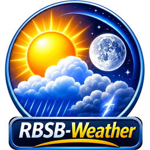

The Android version of RBSB-Weather. It's a **separate app** from
[RBSB-Weather for the desktop](https://github.com/shanebl030-glitch/RBSB-Weather),
with its own versions, releases and tests.

**Created By Shane BlackbuRn**

**Designed and Created By Shane BlackbuRn** · **Coded By Claude AI**

## What it does (0.7)

- Search for any city or town and save up to 50 places. Swipe between them.
- The desktop app's animated sky, ported: the Sun and the Moon in its real
  phase and tilt (NASA images), stars, layered clouds drifting with the real
  wind, rain with splashes, snow, fog and lightning, blending as the weather changes.
- The temperature, feels like, high and low, humidity, wind and gusts, pressure,
  cloud cover, rain, UV index, sunrise and sunset.
- A 24-hour chart and the 7-day forecast.
- Pull down to refresh. It also updates by itself when the weather gets old.
- Works offline with the last saved forecast.
- Weather Providers: Open-Meteo and MET Norway (no key), plus OpenWeather,
  WeatherAPI.com, Visual Crossing, Tomorrow.io and Weather Underground with your
  own free keys. Choose a primary and backups, test a connection, and choose
  when to go back to the primary after it fails.
- Forecast playback: an hour a second, or drag through the next 24 hours.
- The mini forecast in the sky, and animated icons in the 7-day list.
- Animated home-screen widgets (a looping animation; see the user guide).
- Weather warnings from MetService, the US National Weather Service, MET Norway and
  MeteoAlarm, plus your own limits: banner, badges, Warnings screen, notifications.
- Earthquakes from USGS and GeoNet, with notifications for quakes near your places.
- A Moon tab: tonight's Moon turned as in that sky, phase, rise and set, the next
  phases and 7 days, and a high-resolution picture to save.
- An Earth tab: day and night across the world with city lights and live satellite
  clouds, as a flat map or a globe with the real Sun, Moon and stars behind it, your
  places and earthquakes.
- A Wind tab: the world's wind, temperature, and rain and snow from NOAA on a globe,
  with moving wind streaks.
- Check for updates (from GitHub, checked against SHA256SUMS, then Android asks you to install it), Test connection, and an
  optional temperature in the status bar.
- 📍 My location (0.7, Android only): a place that follows your phone to another suburb,
  town or country, and the widget and status-bar temperature can follow it too
  (also while the app is closed, with "Allow all the time" location access).
- See [PARITY.md](PARITY.md) for every desktop feature and its Android status.
- °C/°F, km/h · m/s · mph · knots, mm/inches, 12/24-hour time.

Needs **Android 10 or newer**.

## Screenshots

From RBSB-Weather for Android 0.6.2 on Android 14 (the warning screens use an example warning).

<table>
<tr><td align="center" width="33%">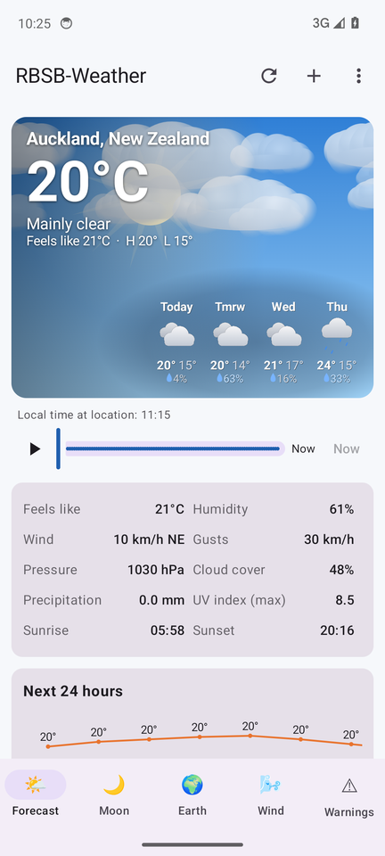<br><sub>Forecast: the animated sky, mini forecast and details</sub></td><td align="center" width="33%">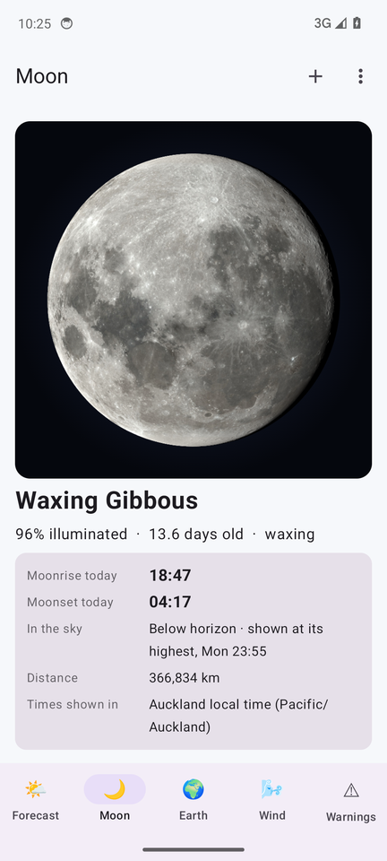<br><sub>Moon: tonight's Moon as it looks in your sky</sub></td><td align="center" width="33%">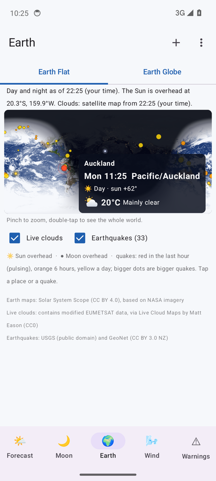<br><sub>Earth Flat: day and night with city lights</sub></td></tr>
<tr><td align="center" width="33%">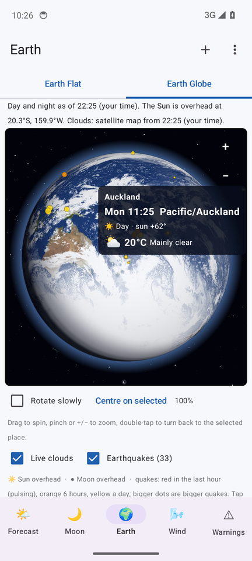<br><sub>Earth Globe: drag, pinch, rotate slowly</sub></td><td align="center" width="33%">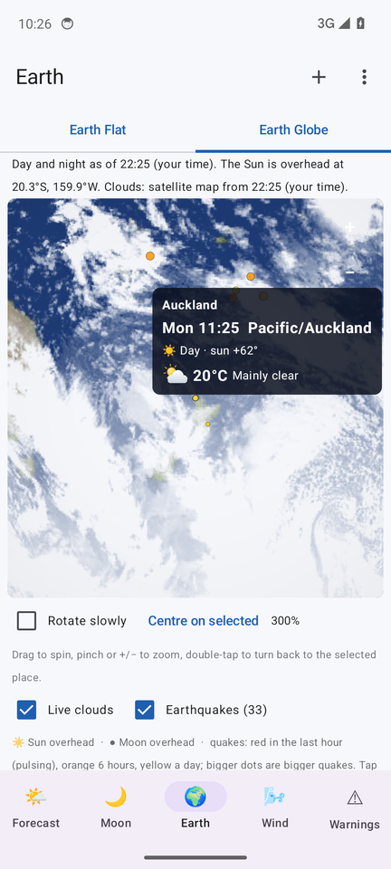<br><sub>Live satellite clouds, zoomed in</sub></td><td align="center" width="33%">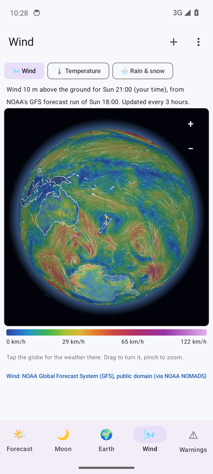<br><sub>Wind: NOAA's forecast with moving streaks</sub></td></tr>
<tr><td align="center" width="33%">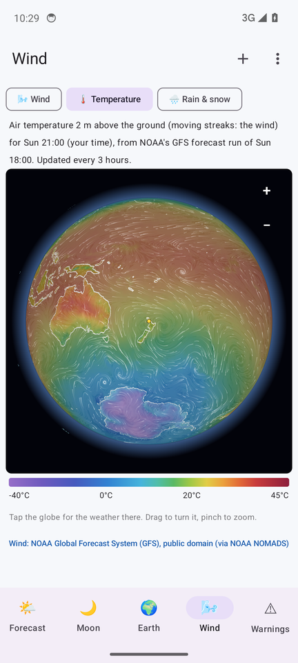<br><sub>Wind tab: air temperature</sub></td><td align="center" width="33%">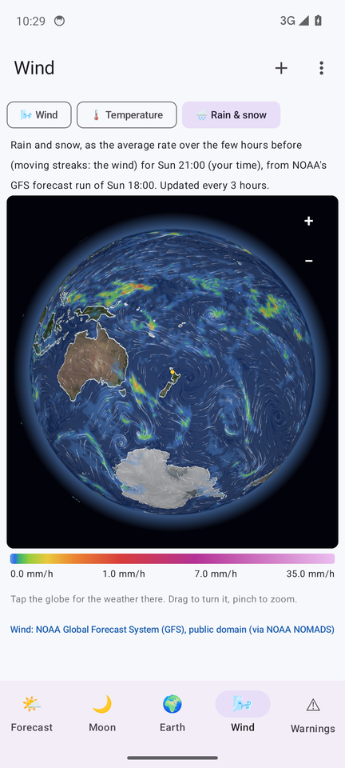<br><sub>Wind tab: rain and snow</sub></td><td align="center" width="33%">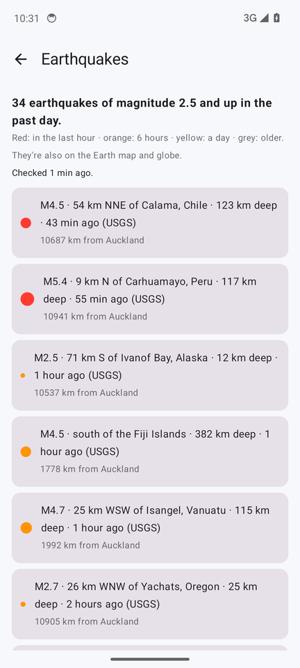<br><sub>Earthquakes near your places</sub></td></tr>
<tr><td align="center" width="33%">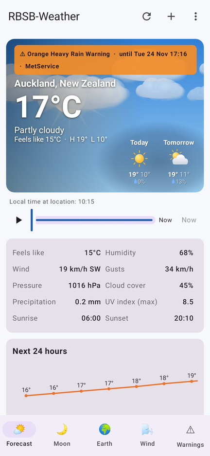<br><sub>A warning across the sky (example)</sub></td><td align="center" width="33%">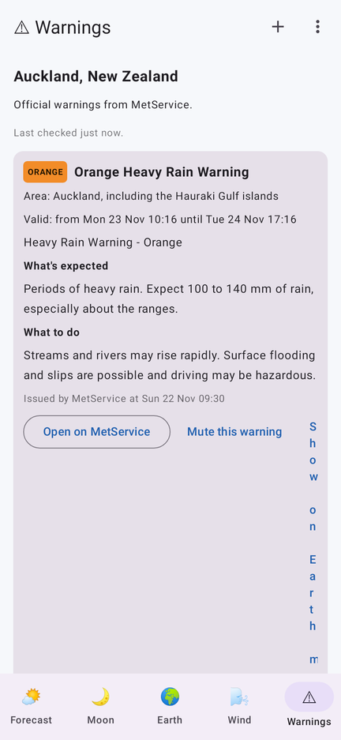<br><sub>The warning in full (example)</sub></td><td align="center" width="33%">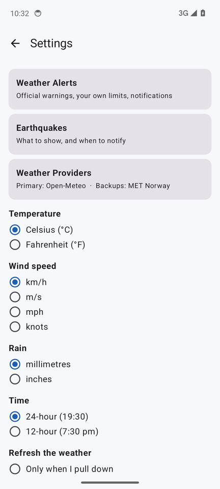<br><sub>Settings</sub></td></tr>
<tr><td align="center" width="33%">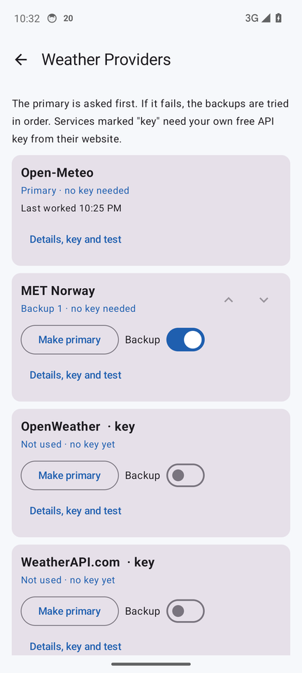<br><sub>Weather Providers</sub></td><td align="center" width="33%">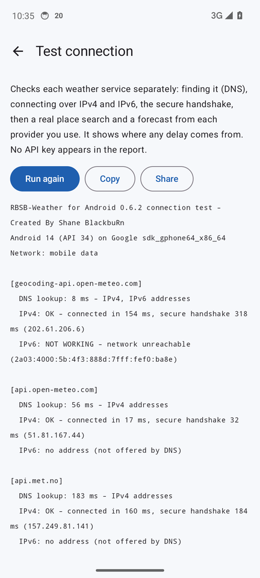<br><sub>Test connection</sub></td><td align="center" width="33%">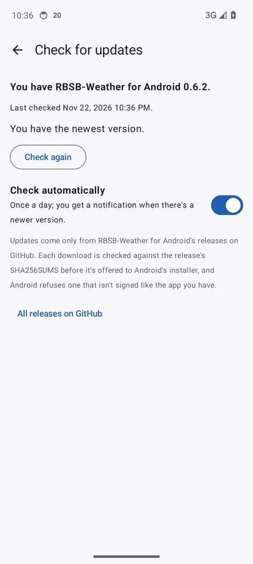<br><sub>Check for updates</sub></td></tr>
</table>

<p align="center">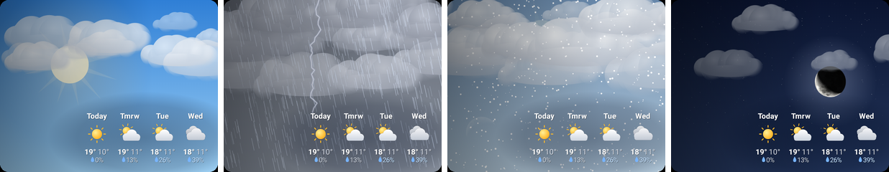<br><sub>The animated sky: sun and cloud, a thunderstorm, snow, and night with the Moon in its real phase</sub></p>

<table>
<tr><td align="center" rowspan="2" width="34%">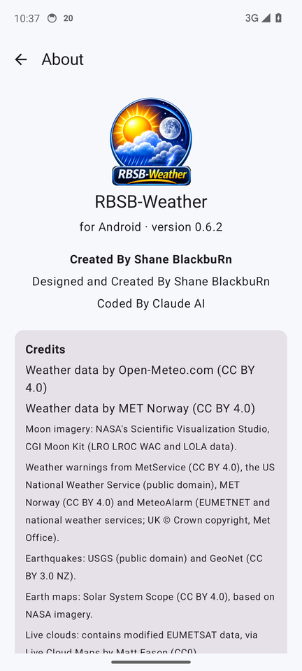<br><sub>About</sub></td>
<td align="center">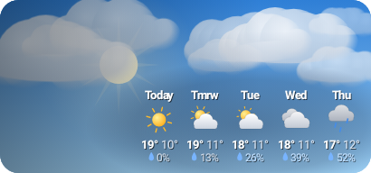<br><sub>Home-screen widget (animated)</sub></td></tr>
<tr><td align="center">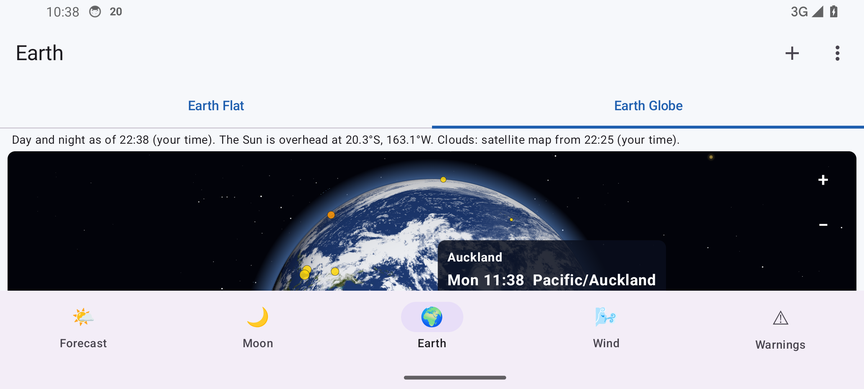<br><sub>Turned sideways</sub></td></tr>
</table>

## Install

1. On your phone, download `rbsb-weather-android_0.6.2.apk` from the
   [latest release](https://github.com/shanebl030-glitch/RBSB-Weather-Android/releases/latest).
   (Test builds of work in progress are on the
   [test-builds branch](https://github.com/shanebl030-glitch/RBSB-Weather-Android/tree/test-builds).)
2. Open it. Android asks to allow installing apps from this source (for example
   Chrome or Files). Allow it once.
3. Tap **Install**.

New test builds install over the old one, and your places are kept.

To check the download, compare its SHA-256 with `SHA256SUMS`.

### "Google Play Protect: Harmful app blocked"

From version 0.6, Google Play Protect may show this when you install RBSB-Weather
for Android:

> Harmful app blocked. RBSB-Weather. This app may be harmful. Installing this app
> may put your device at risk. — **Install anyway**

**Why it appears.** Since 0.6 the app can update itself: **Menu → Check for updates
→ Download and install**. To do that it needs Android's "install other apps"
permission (`REQUEST_INSTALL_PACKAGES`). Play Protect warns about any app installed
from outside the Play Store that has that permission, because it can't tell an app
updating itself from one installing something else. Versions up to 0.5.2 didn't
have it and installed without the warning.

**What the app actually does with it.** It only ever installs RBSB-Weather for
Android, and only when you tap **Download and install**:

1. It downloads only from this repository's releases on GitHub (no other address
   is followed).
2. It checks the file against the release's published `SHA256SUMS`. If they don't
   match, it deletes the file.
3. It checks that the file is RBSB-Weather for Android and newer than the version
   you have.
4. It hands the file to Android's own installer, which asks you first. Android
   refuses an update that isn't signed with the same key as the app you have.

All the code is in this repository: `data/Updates.kt` and `background/Installer.kt`.

**To install,** tap **Install anyway** (on some phones: **More details → Install
anyway**). You can check the APK first: its SHA-256 must match the line for it in
`SHA256SUMS` on the release page.

**If you'd rather not allow it,** don't install. Up to 0.5.2 the app has no
update feature and no warning.

**Uninstall:** long-press the app icon → App info → Uninstall.

## Signing

Test builds (0.x) are signed with a **test key** kept in this repository
(`keystore/rbsb-test.keystore`), so every test build installs over the last.

Before any public release, a private release key replaces it. That key is kept
by Shane and never put in the repository. Moving from the test key to the
release key means uninstalling the test build once.

## Building

Every push is built by GitHub Actions (`.github/workflows/android.yml`):

1. the tests run first;
2. then the APK is built;
3. the newest test build goes to the `test-builds` branch.

To build on your own computer, you need JDK 17 and the Android SDK:

```bash
./gradlew testDebugUnitTest assembleRelease
```

## Project layout

| Path | Purpose |
|---|---|
| `app/src/main/java/.../data/` | Weather data: every provider and its parser, the normaliser, the primary/backup chain and recovery, API keys, the offline cache, settings, units, the Sun |
| `app/src/main/java/.../widget/` | The home-screen widgets |
| `app/src/main/java/.../ui/` | The app's state (`AppModel`), the animated sky with playback and the mini forecast, the 24-hour chart, the screens (including Weather Providers) |
| `app/src/main/assets/USER_GUIDE.md` | The in-app user guide |
| `app/src/test/` | Unit tests and Robolectric screen tests, with forecast samples shared with the desktop app's tests |

## Data and privacy

Only the coordinates of your saved places (and what you type when searching) are
sent, and only to the weather services you've chosen. If you turn on 📍 My
location, the phone's position is rounded to about 100 m first and treated
the same way; if the phone can't name the spot, that rounded position is also
sent to OpenStreetMap's Nominatim to get the suburb's name. It's never sent anywhere else. Location access is only asked for
when you turn it on. API keys you enter are
kept in the app's private storage, apart from the settings, and are excluded
from phone backups. There's no tracking and no account.

Weather data by Open-Meteo.com (CC BY 4.0) and MET Norway (CC BY 4.0); with
your keys, OpenWeather (CC BY-SA 4.0), WeatherAPI.com, Visual Crossing,
Tomorrow.io and Weather Underground / The Weather Company. Weather warnings from MetService (CC BY 4.0), the US National Weather Service
(public domain), MET Norway (CC BY 4.0) and MeteoAlarm. Earthquakes: USGS (public
domain) and GeoNet (CC BY 3.0 NZ). Moon imagery: NASA's
Scientific Visualization Studio, CGI Moon Kit (LRO LROC WAC and LOLA data).
Place names for My location, when the phone can't give one: © OpenStreetMap contributors (Nominatim).

Created By Shane BlackbuRn
