# RBSB-Weather-Android 0.6.2

Created By Shane BlackbuRn

## What's new since 0.5.2

- **Wind tab:** the world's wind, temperature, and rain and snow from NOAA's GFS forecast on a globe, with moving wind streaks.
  - Drag, pinch, or tap anywhere for the weather there.
  - Updated every 3 hours and kept for offline use.
- **Check for updates (menu):** checks this page for a newer version, shows what's new, and downloads and installs it when you tap **Download and install**.
  - Each download is checked against `SHA256SUMS` before Android asks you to install it.
  - The app also checks once a day and notifies you (you can turn this off in Settings).
- **Test connection (menu):** checks how your phone reaches each weather service and where any delay comes from. You can copy or share the report.
- **Temperature in the status bar (Settings):** an optional quiet notification with the temperature as its icon.
- **Provider usage:** for the services that report it, such as Tomorrow.io's requests left today.

## Screenshots

<table>
<tr><td align="center" width="33%">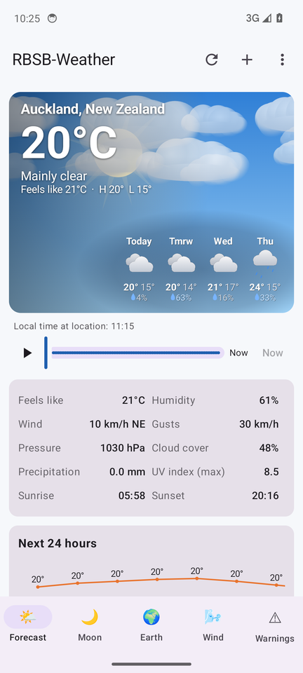 Forecast: the animated sky, mini forecast and details</td><td align="center" width="33%">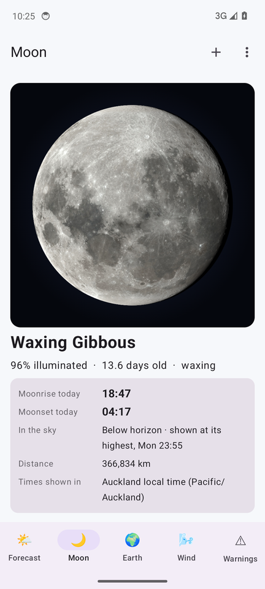 Moon: tonight's Moon as it looks in your sky</td><td align="center" width="33%">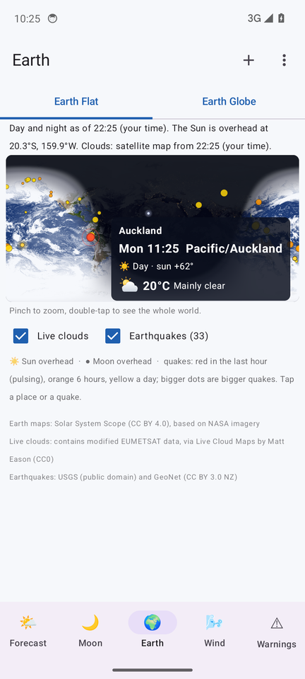 Earth Flat: day and night with city lights</td></tr>
<tr><td align="center" width="33%">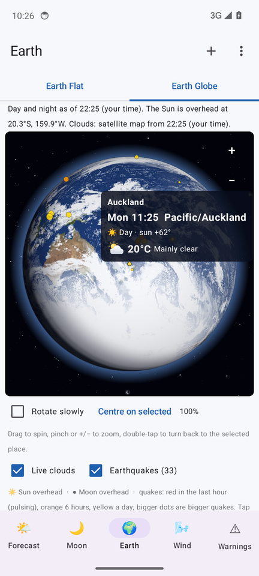 Earth Globe: drag, pinch, rotate slowly</td><td align="center" width="33%">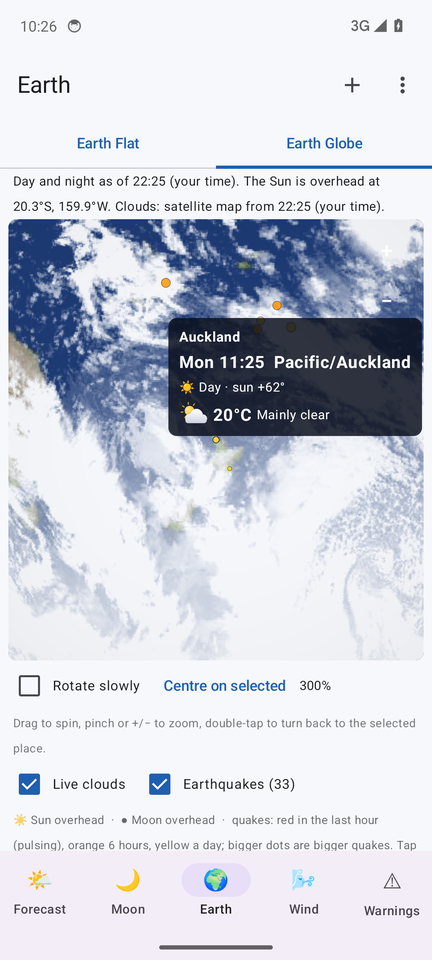 Live satellite clouds, zoomed in</td><td align="center" width="33%">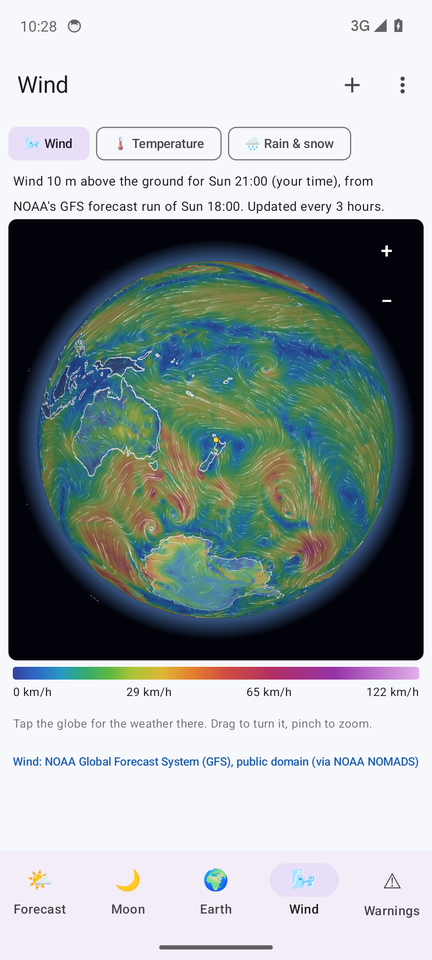 Wind: NOAA's forecast with moving streaks</td></tr>
<tr><td align="center" width="33%">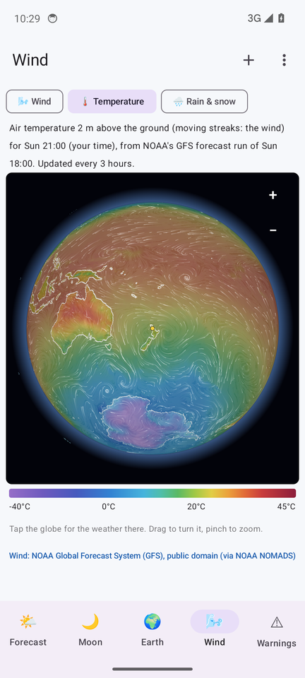 Wind tab: air temperature</td><td align="center" width="33%">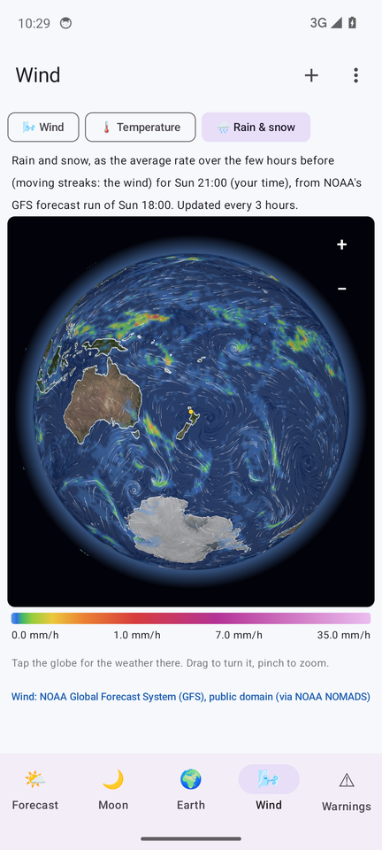 Wind tab: rain and snow</td><td align="center" width="33%">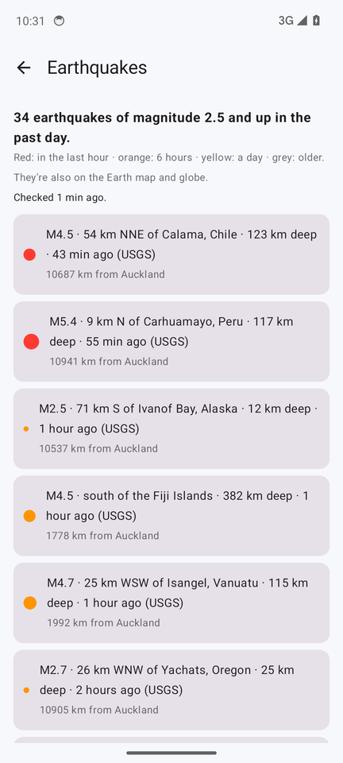 Earthquakes near your places</td></tr>
<tr><td align="center" width="33%">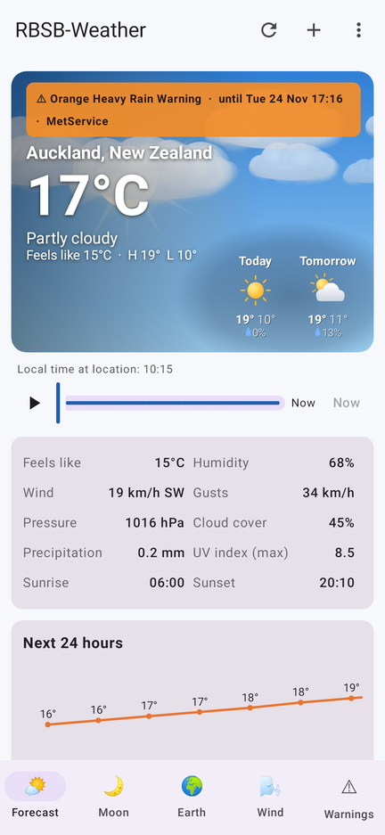 A warning across the sky (example)</td><td align="center" width="33%">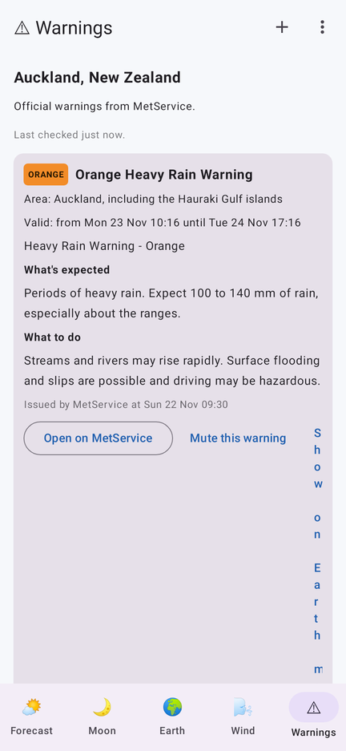 The warning in full (example)</td><td align="center" width="33%">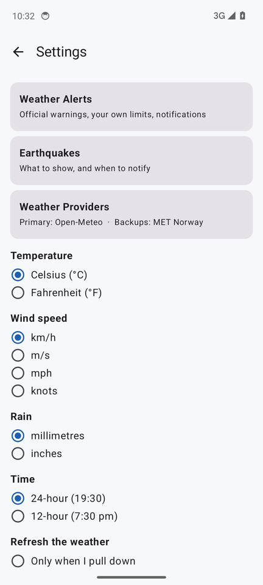 Settings</td></tr>
<tr><td align="center" width="33%">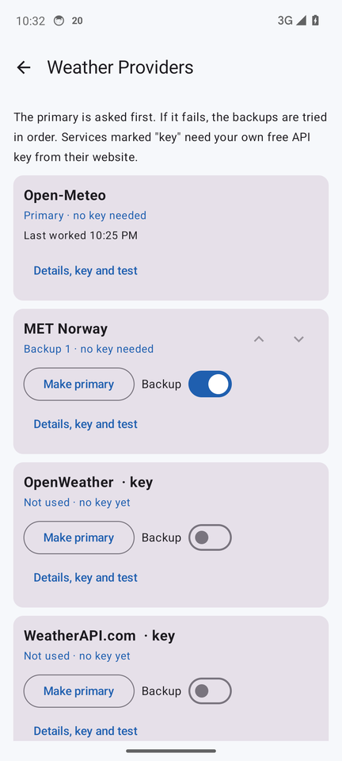 Weather Providers</td><td align="center" width="33%">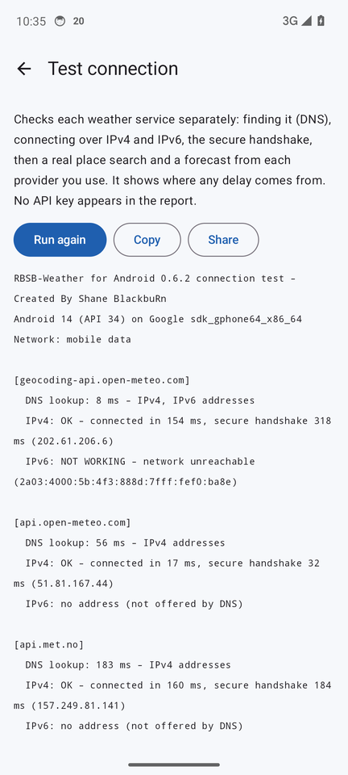 Test connection</td><td align="center" width="33%">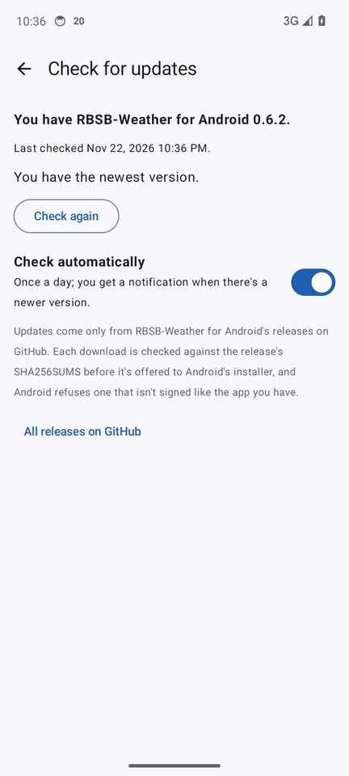 Check for updates</td></tr>
</table>

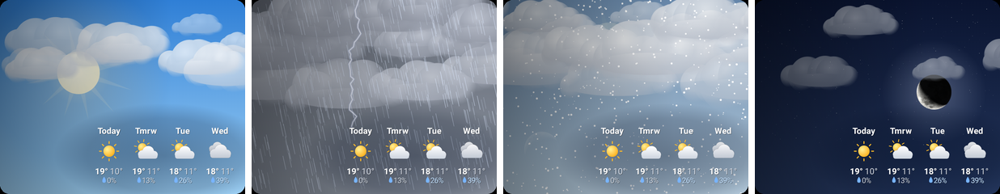 The animated sky: sun and cloud, a thunderstorm, snow, and night with the Moon in its real phase

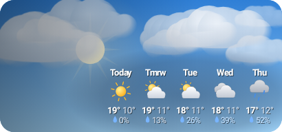 Home-screen widget (animated)&nbsp;&nbsp;&nbsp;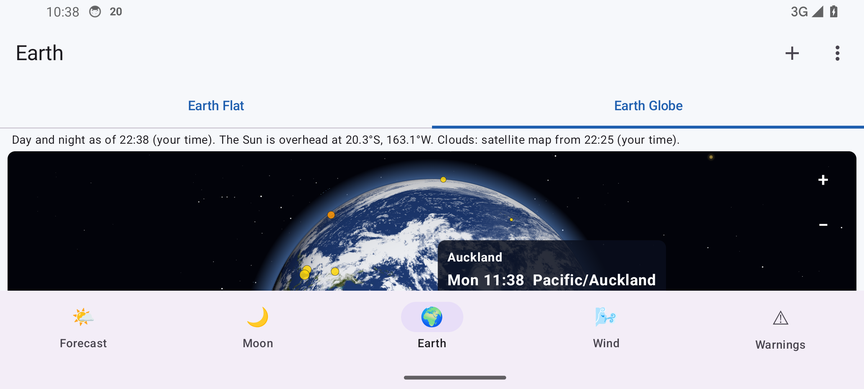 Turned sideways

## Google Play Protect warning

When you install this version, Google Play Protect may say **"Harmful app blocked … This app may be harmful."**

This is because the app can now install its own updates. That needs Android's "install other apps" permission, and Play Protect warns about any app from outside the Play Store that has it. RBSB-Weather only ever installs RBSB-Weather for Android, from this page's releases:
- It checks the file against `SHA256SUMS`, and that it's this app and newer.
- Android itself asks you before installing, and refuses an update not signed like the app you have.

To install, tap **Install anyway** (on some phones: **More details → Install anyway**). To check the file first, its SHA-256 must match the line for it in `SHA256SUMS` below. See the [README](https://github.com/shanebl030-glitch/RBSB-Weather-Android#google-play-protect-harmful-app-blocked) for the full explanation.

## Files

- `rbsb-weather-android_0.6.2.apk`: install on Android 10 or newer. It installs over earlier versions and keeps your places.
- `SHA256SUMS`: the checksum of the APK.
